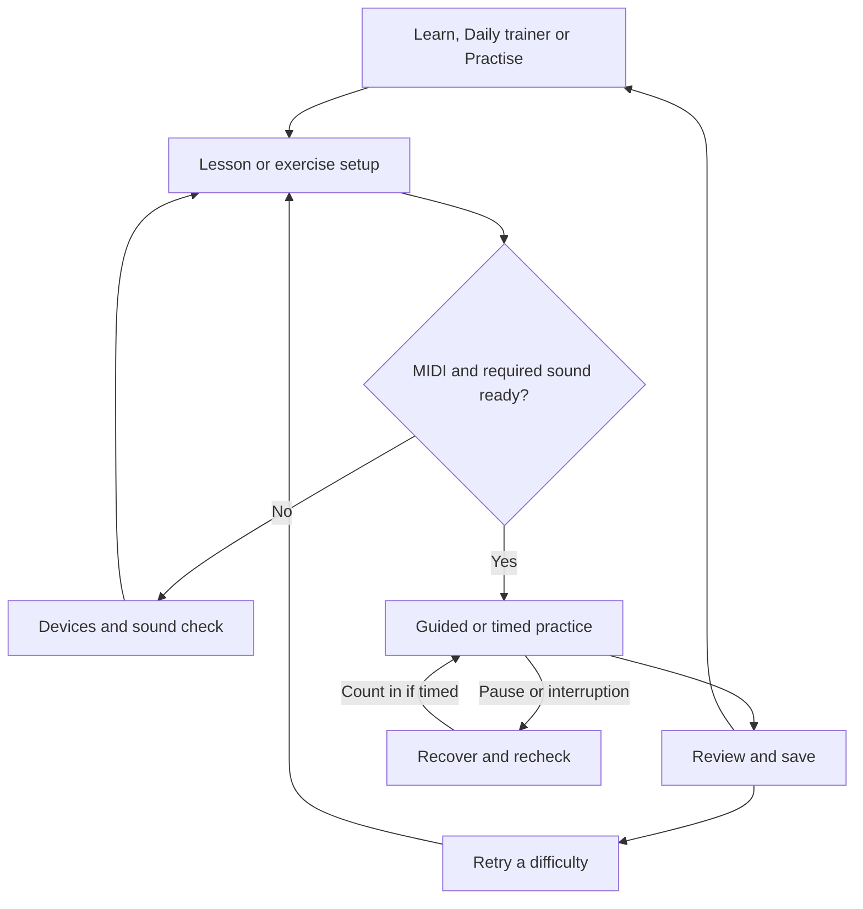

# Piano learning app design

**Version:** 0.3 - 9 October 2026  
**Status:** Proposed product and UX specification for discussion. No features are claimed to be implemented.  
**Scope:** Beginner curriculum, screens, interactions, MIDI feedback, assessment and data ownership. Naming, logo design and commercial strategy are excluded.

**Revision 0.3:** Added a dedicated Daily trainer that the learner can simply start and follow. A prepared routine runs automatically through short finger-pattern, control, coordination and speed exercises, using remembered settings and separate levels by skill. USB and Bluetooth MIDI remain first-release requirements from revision 0.2.

This document follows the structure of the supplied indoor cycling specification: choose an activity, prepare the equipment, practise with live feedback, review the result and keep the record. Its companion PDF contains visual screen concepts and a concise overview. This Markdown file is the complete, editable reference and takes precedence over illustrative screens.

## 1 Product intent

A beginner piano web app that connects to a MIDI keyboard and helps the learner understand what they play. The main priorities are **reading notation** and **understanding harmony**. Scales, broken chords, arpeggios, rhythm and simple musical applications reinforce those priorities.

The central learning loop is: understand a small idea, hear and see it, play it, receive useful feedback, then apply it in a new example. Theory belongs beside the keyboard and staff, with the same notes highlighted across each representation when help is enabled.

The app should help a beginner:

- Find notes on the keyboard and read a growing range in treble and bass clefs.
- Read single notes, intervals, chords and short phrases with fewer hints over time.
- Build major and minor triads, understand inversions and play simple progressions.
- Play short scale and arpeggio patterns accurately, then improve pulse and evenness.
- Hear differences between intervals and chords and explain basic musical relationships.

**Working assumptions, not user-confirmed decisions:** self-directed adult or teenage beginners; desktop or laptop; English note names; scientific pitch notation with middle C labelled C4; no mandatory account. Exercises adapt to a confirmed playable range rather than assuming 88 keys. A smaller controller can support a restricted subset.

**Confirmed scope:** key-based practice is fundamental. Arpeggios, scales and related harmony drills must be available in C, G or any other key. The practice engine supports all 12 tonic pitch classes from the first release; the lesson path introduces keys gradually. Availability is not gated by lesson completion.

**Confirmed connection requirement:** support both USB MIDI and Bluetooth MIDI, including external Bluetooth MIDI adapters attached to a keyboard's MIDI connectors. Built-in Bluetooth MIDI is also in scope. Wireless connectivity must carry MIDI note/control events; Bluetooth audio pairing alone does not satisfy this requirement.

**Confirmed daily-trainer requirement:** a dedicated tab provides a ready-made routine that the learner can "just do": open it, press Start and follow the session. Basic movement exercises develop finger-pattern control, coordination and speed at separate levels. Choosing exercises or configuring a workout each day is not required.

This is a companion for learning and deliberate practice. Ordinary MIDI can support pitch and event-timing checks, but cannot directly establish fingering, hand identity, posture or tension. The product must not turn those unobserved qualities into scores.

## 2 Navigation and main flow

| Section | Purpose | Main actions |
|---|---|---|
| Learn | Follow the beginner sequence | Start, continue, revisit an explanation, try a check |
| Daily trainer | Start and follow a prepared daily routine | Start or resume, pause, slow down, skip, optionally adjust, review progress |
| Practise | Choose a focused drill | Browse, configure, start, save a preset |
| Explore | Experiment with notes and harmony | Play freely, compare chords, hear examples |
| Progress | Review evidence of learning | Inspect skills, sessions and specific difficulties |
| Devices | Set up MIDI and sound | Choose USB or Bluetooth MIDI, connect, test notes, confirm range, select sound |

Your data is available from Progress and Settings. During an exercise, a focused practice screen replaces the main navigation, with Pause, End and device status always accessible.

The app opens on Learn by default. Returning learners see Continue lesson, Open daily practice and Browse practice; they may set Daily trainer as their preferred start tab. Nothing requires maintaining a streak. Browsing, explanations and on-screen exploration work before a keyboard is connected; measured keyboard practice requires a tested input.

First use offers Start from the beginning or a short optional placement check. An inexperienced user may skip the check. A placement result suggests a starting lesson; it does not lock the learner out of other content.

## 3 Beginner curriculum

The sequence below is a product proposal, to be reviewed with a piano educator. It is not an exam syllabus or a claim of a validated teaching method. Established beginner piano assessment includes notation, scales and arpeggios, pieces and aural work; those categories help check that the product is not limited to note matching. [5]

| Stage | Understanding | Play and check | Evidence to retain |
|---|---|---|---|
| 1 Keyboard and pulse | Black-key groups, note letters, high and low, middle C, a steady beat | Find named notes; imitate a small pattern; repeat one note with a pulse | Pitch, octave, repeated attacks; timing only in pulse tasks |
| 2 First reading | Treble and bass clefs, landmark notes, steps and skips, quarter and half notes, rests | Read a small range around landmarks; then short one-hand phrases | First-attempt accuracy by clef, position and hint level |
| 3 Intervals and scales | Semitone and tone, interval names, major-scale pattern, sharps and flats | Play intervals and five-note patterns; introduce C major, then G and F | Interval size and spelling understanding; correct sequence |
| 4 Triads and inversions | Root, third and fifth; major versus minor; root position and inversions | Build C, F and G major and A minor; change C major into C minor; read triads | Chord tones, bass note, exact voicing when requested |
| 5 Harmony in motion | Scale degrees; tonic, subdominant and dominant; common tones and cadences | I-IV-V-I in C; broken chords and short arpeggios; simple bass plus chord | Correct progression, voice-leading task and transitions |
| 6 Reading and application | Grand staff, simple coordination, key signatures and a minor-key introduction | Short original two-hand studies; transpose a learned shape; read unfamiliar phrases | Separate reading, harmony and timing evidence |

Reading and harmony develop alongside each other. Bass clef appears early in small doses. Do not require fluent sight-reading before introducing simple chords, or all major scales before explaining a triad. Introduce minor scales, seventh chords, broader key coverage and longer hands-together patterns after the core material.

### A lesson and a short session

A lesson takes roughly 5-10 minutes, with no forced countdown: one idea, an audible demonstration, supported attempts, recall without hints and a short application. Explanations use a sentence or two at a time. New notation is named before the learner is scored on it.

Example optional 12-minute session: 2 minutes reviewing landmark notes, 4 minutes building major and minor triads, 3 minutes playing a C-major arpeggio, 2 minutes applying C-F-G-C in a short study, and 1 minute reviewing the result. Durations are suggestions and do not affect achievement.

Add educational variety through call-and-response, identifying a heard major or minor chord, finding a missing chord tone, comparing two inversions and improvising a short answer using allowed notes. Ear-training questions may use buttons for conceptual answers and MIDI for played answers. Creative exploration has constraints and observations, not a single artistic correctness score.

## 4 Learn and lesson screens

Learn shows a compact path of named lessons grouped by skill. Each card explains what the learner will do, the approximate time and prerequisites. Display Not started, Practising or Demonstrated, with the evidence behind the latter available on demand.

Selecting a lesson opens an overview with its goal, a short preview and Start. The device drawer returns to that lesson. An optional demonstration animates the staff and keyboard together while playing sound.

Within a lesson, use five steps:

1. **Understand:** one concept, such as a major triad containing a root, major third and perfect fifth.
2. **Observe:** show and hear C-E-G; link the notation, keyboard and interval labels.
3. **Try with help:** highlight target keys and explain a mismatch.
4. **Recall:** remove target-key highlights and note-name hints; record assistance if requested.
5. **Apply:** change the root, read a new voicing or use the chord in a short phrase.

The learner can replay the explanation, slow the demonstration or leave at any point. Demonstration playback is never counted as learner input. A skipped or assisted task is stored honestly and does not appear as an independent success.

## 5 Daily trainer

This is a dedicated main-navigation tab, distinct from the lesson path and the exercise catalogue. It answers: **What basic movements should I practise today, at my current level?** The first release includes repeatable finger patterns, steady repetition, simple position changes and coordination tasks. These use the same key selection, USB/Bluetooth input, evaluator and saved evidence as other exercises.

### Ready to start

The primary action is **Start today's session**, or **Resume session** when today's routine is partly complete. A ready keyboard and saved preferences are sufficient. Do not ask the learner to pick an exercise, key, skill, tempo or level each day. Show the estimated duration and a compact preview of the prepared tasks; put all customization behind a secondary Adjust routine action.

Remember the preferred session length, key pool, hand instructions, current level in each skill, demonstrated tempos and sound/input setup. Initial defaults are a 10-minute beginner routine, C major, level 1 patterns, hands separately and guided support. Where a timed task is introduced, propose a deliberately simple quarter-note pattern at 60 BPM with a prominent Slower control; this starting value is a prototype parameter to test, not a universal appropriate pace. A placement check is optional and never blocks the first daily session.

Prepare a balanced routine automatically: a familiar opening, one current movement focus, a short pulse/speed task and a familiar musical application. Use recent evidence to choose the focus within the learner's current levels. Keep successful patterns in rotation while varying equivalent examples. Introduce at most one new challenge dimension at a time; do not increase key difficulty, pattern complexity and tempo together. With no evidence, use the authored beginner routine rather than inventing a proficiency estimate.

Default to 10 minutes, with optional 5- and 15-minute choices remembered for future sessions. These are estimated active session lengths including scheduled reset breaks and transitions. Pauses or guided corrections can extend wall-clock time. Finish the current short phrase before moving on rather than cutting it off at a time limit. Ending early preserves completed tasks and partial attempts. A missed day does not reset skill evidence or create a backlog.

### One continuous session

1. **Start once:** check the saved MIDI input; if it is unavailable, show the connection step and return directly to this routine.
2. **Show and count in:** display the pattern and instructional fingering; demonstrate it when needed, then give a count-in for timed work. Never score the demonstration.
3. **Play and repeat:** run the configured short attempts with immediate, restrained feedback. Pause, Slower, Replay example and Skip task stay available.
4. **Move on automatically:** show a brief result, take a short visible reset break and load the next task with its next count-in. The learner can extend the break. No catalogue visit or mandatory Next button is required.
5. **Finish and save:** show the work completed, a specific observation and any optional progression suggestion. Mark today's session Done; further practice is optional and is labelled as another attempt.

Automatic transitions stop while paused, disconnected or awaiting key release. Follow the existing reconnection and count-in rules before continuing. A repeated difficulty can offer a slower or guided version without sending the learner through setup again.

Each task retains its skill, pattern, level, key, hand instruction, tempo/subdivision, duration or repetition target, and a short reason for inclusion. The learner can inspect those details, preview finger guidance, swap a task, lower difficulty or change key through Adjust routine. These controls provide an escape hatch without becoming steps in the normal start flow.

| Example 10-minute routine | Time | Purpose |
|---|---:|---|
| Settle in | 2 min | Comfortable five-note pattern, initially hands separately |
| Movement and control | 3 min | A pattern from the learner's current finger-pattern or position-change level |
| Steady speed | 3 min | Short timed attempts at an established tempo, with reset breaks |
| Apply in a key | 2 min | A familiar scale fragment, broken chord or arpeggio in the selected key |

Routine dates follow the learner's configured local timezone. Save the generated task list and current position for that date; returning later restores the same routine with Resume session. Swaps create explicit revisions. A new day prepares a new routine while retaining any earlier partial record; it does not create unfinished homework. This tab does not require reminders, notifications or a compulsory daily schedule.

### Levels across skills

Each track has its own level. A learner might use level 3 finger patterns, level 1 coordination and a modest tempo in G major. Pattern complexity, tempo and key fluency are separate controls. Guided versions remain available at every level.

| Skill track | Level 1 | Level 2 | Level 3 | Level 4 |
|---|---|---|---|---|
| Finger patterns | Five adjacent notes up and down | Neighbor pairs and short alternations | Skips and reordered patterns | Longer combinations with changes of direction |
| Pulse and evenness | Repeat one note at a comfortable pulse | Alternate two notes evenly | Maintain a specified subdivision through a pattern | Short faster bursts followed by controlled recovery |
| Position changes | Stay in one five-note position | Move to a neighboring position after a rest | Follow a scale passage with suggested crossing fingering | Connect a wider scale or arpeggio pattern |
| Coordination | Right- and left-hand instructions separately | Alternate the instructed hands | Play a simple matching pattern together | Combine short contrasting rhythmic patterns |

These are proposed exercise levels, not piano grades. Advanced levels within this tab remain bounded basic skills; they do not imply advanced musicianship. Authored patterns and fingering annotations require educator review, including suitability for hand size and the selected key. Never transpose a C-major fingering mechanically into every other key.

Examples in a five-note C position include C-D-E-F-G-F-E-D-C with suggested right-hand fingering 1-2-3-4-5-4-3-2-1; the left-hand annotation for the same ascending pitches differs. An adjacent-pair task might use C-D-C-D followed by D-E-D-E. A later reordered task can use C-E-D-F-E-G. The note sequence and the finger guidance are stored separately and regenerated or selected appropriately for the chosen key and hand instruction.

MIDI checks the resulting note attacks, order, timing and releases. It does not identify fingers or verify which hand played a note. “Finger-pattern control” therefore describes the instructional goal; results say “notes accurate,” “timing steady” or “observed gaps,” not “finger 4 improved” or “correct hand technique.” Hand instructions are configuration, not a measured fact. Optional comfort or ease ratings are learner reports.

### Speed progression

Begin with a short guided accuracy attempt, then use the saved tempo for that pattern or the visible beginner default, with Slower always available. The normal daily flow does not require a tempo-selection dialog. Show BPM together with note value or notes per beat. For example, 60 BPM with eighth notes is two note attacks per beat in a single-note pattern; it is not equivalent in speed to 60 BPM with quarter notes.

Proposed progression rule: two complete, unassisted attempts at the same settings, each matching at least 95% of expected targets within the stated timing window, with no extra attacks or timing interruption, can offer **Try +2 BPM** for the next attempt. Place the optional increase and a brief comfort check in the task or session summary; neither blocks continuing the routine. Without acceptance, retain the current tempo. This is an adjustable product heuristic to test with beginners, not a validated universal training rule. The learner can stay at the current tempo or reduce it at any time.

Do not increase speed during an attempt. Repeated errors suggest a slower tempo, a smaller pattern or guided practice. A faster attempted tempo is not a demonstrated tempo. Store the fastest qualifying tempo with its key, hand instruction, pattern, level, subdivision, tolerance profile and date. A new key or harder pattern starts from its own evidence or a learner-chosen comfortable tempo, not the best speed achieved elsewhere.

Increase a skill level only after the current patterns have been demonstrated across fresh examples and the learner accepts the next challenge. Tempo progress does not automatically advance coordination or position-change levels. Daily review shows completed work, one concrete observation and a suggested focus for the next visit, with no punitive streak requirement.

## 6 Practice catalogue and exercise setup

| Family | Example prompt | Main checks |
|---|---|---|
| Note reading | Read the displayed F4 | Exact pitch and octave |
| Interval reading | Play the two written notes | Both pitches; together or separately as specified |
| Chord reading | Play this written triad | Exact written voicing |
| Chord building | Build a C-minor triad | C, E-flat and G; required inversion if specified |
| Scales and patterns | Play C major ascending | Ordered attacks, optional rhythm and releases |
| Broken chords and arpeggios | Play C4-E4-G4-C5-G4-E4-C4 | Order, register, turn and optional timing |
| Progressions | Play I-IV-V-I in C | Chord identity, allowed voicings and transitions |
| Rhythm | Repeat C4 in this rhythm | Onsets, rests and optional held duration |
| Short reading studies | Play an unfamiliar two-bar phrase | Notes, rhythm and recovery through the phrase |
| Listening and application | Hear a chord, then play its missing third | The answer required by the specific task |

Cards show the goal, difficulty, required range, input requirement and available modes. Filters include skill, clef, key, range, hand instruction and approximate length. Begin with authored templates and configurable presets; a general exercise editor is a later feature.

Setup exposes only controls relevant to that family: clef, range, key and tonality (major or minor), allowed accidentals, one or both hands, pattern direction, octave span, repetitions or item count, practice mode, hints, tempo and count-in. Key is a primary control for scales, arpeggios and harmony, not an advanced setting. Advanced settings contain scoring tolerance. Validate incompatible choices before starting.

Show a staff preview and the actual lowest and highest target notes. Confirm that the exercise fits the selected keyboard range. Offer an explicit narrower pattern or another exercise if it does not; do not silently transpose written notes. A saved preset has an ID and revision. At start, snapshot the fully generated sequence, its seed when used, settings, content revision and evaluator version into the attempt.

## 7 Note reading

The staff is the primary prompt. A keyboard diagram supports learning but can be hidden. Falling-note graphics are not the primary reading interface because the stated goal is reading standard notation.

Start with single notes around landmarks such as middle C and the clef reference notes. Expand the range gradually, interleave treble and bass, then introduce intervals, simultaneous chords and short phrases. Use small musically sensible ranges rather than uniformly random notes across the entire keyboard.

### Two complementary modes

- **Guided:** wait for the correct response. Wrong notes receive a concise cue; the learner can correct them. There is no speed penalty. Store first attempt, retries and hint use separately from eventual completion.
- **Timed:** give a count-in, then keep the musical timeline moving. Evaluate pitches, rests and rhythm; show detailed corrections after the phrase. Slow tempo and short phrases make this approachable.

A single-note prompt advances once after a fresh correct note-on. Require release before a subsequent prompt can accept a new attack of that same pitch. Holding a key cannot complete a queue of prompts.

For a simultaneous notation prompt, compare the held keys with the exact written notes, including octave. A chord labelled only by name may allow several voicings, but a written chord must retain its specific voicing. “Correct note name, one octave too high” should be distinct from a different pitch class.

Store written spelling and sounding MIDI pitch separately. C-sharp and D-flat may map to the same key: MIDI alone cannot reveal which name the learner intended. A spelling question therefore needs an explicit name selection as well as any played response. Key signatures and the applicable accidental scope must affect the target pitch correctly.

Hints progress from identifying the clef or landmark, to naming the note, to revealing the key. Any answer-revealing hint marks the item assisted. A fresh sight-reading attempt cannot have prior answer playback or target-key cues; a replay is practice, even if it is useful.

## 8 Harmony and the Explore screen

Explore links a staff, keyboard, chord label and interval explanation. Playing C-E-G can show C major, with C as root, E as third and G as fifth. Changing E to E-flat demonstrates how a minor third changes the chord quality. The learner can hear the comparison, then rebuild it without highlights.

Introduce one representation at a time; enable more detail as needed. Label inversion through the bass note: E-G-C is C major in first inversion. The chord root remains C. For progressions, initially show C-F-G-C alongside I-IV-V-I, explaining the Roman numerals before relying on them.

Suggested activities include building a chord from a root, filling a missing third, sorting major and minor by ear, playing a requested inversion, retaining a common tone between chords and finding a nearby voicing. Use original short studies to connect chord symbols, written notes and sound.

| Prompt type | What counts as correct |
|---|---|
| Play the written C4-E4-G4 | Exact MIDI pitches; no additional held notes |
| Build C major in any inversion | All three chord pitch classes in the allowed range; no outside pitch classes; doubling only if enabled |
| Play C major in first inversion | C-major chord tones with E as the lowest held note; range and doubling rules still apply |
| Keep this common tone | The authored common note remains held across the change; only changed tones need new attacks |
| Find a nearby voicing | One of the authored acceptable solutions, with the movement rule shown |

Free-play chord identification is explanatory, not an exam. Ambiguous sets may have several possible names; use the chosen key and preceding harmony as context and show alternatives where appropriate. An incomplete or unfamiliar set is displayed as notes without inventing a confident chord name. Full harmonic analysis is outside the first release.

## 9 Scales broken chords and arpeggios

Teach the relationship before the motion: a scale is an ordered collection of notes; a broken chord separates chord tones; an arpeggio unfolds chord tones through a specified range. Begin with short one-hand patterns and explicit demonstrations. Suggested finger numbers can be displayed as instructional annotations, but their use cannot be verified by ordinary MIDI.

### Practice in any key

Select **key and tonality**, then the pattern. Default to the tonic triad for arpeggios: C major gives C-E-G, G major gives G-B-D and A minor gives A-C-E. An exercise can later choose another chord degree within that key; the key and the chord being arpeggiated are separate fields. In G major, for example, a V-chord arpeggio uses D-F-sharp-A rather than the tonic G-B-D.

| Selected key | Tonic arpeggio ascending | What changes |
|---|---|---|
| C major | C-E-G-C | Starting example |
| G major | G-B-D-G | New tonic and chord tones |
| D major | D-F-sharp-A-D | F-sharp must appear and be checked |
| F major | F-A-C-F | Key signature has B-flat even though this triad does not use B |
| A minor | A-C-E-A | Minor third above the tonic |
| C minor | C-E-flat-G-C | E-flat changes the chord quality |

Generate from a musical template and the selected key, not from a fixed C-major exercise with generic note labels. Update the key signature, written spelling, staff positions, chord labels, demonstrations, keyboard targets and expected MIDI events together. Use musically appropriate enharmonic key names and store the selected spelling. A major/minor tonic arpeggio and a major/minor scale are different patterns; natural, harmonic and melodic minor scale variants must be named explicitly when introduced.

Support all 12 roots for major scales and major/minor tonic arpeggios in the first release. Beginner lessons can still start in C, then G and F. Deeper minor-scale lessons can follow later. Choose a visible starting octave and validate the resolved range; a proposed octave adjustment needs an explicit preview and acceptance.

Default to practising one key. **Practise selected keys** can rotate through a chosen list, in an authored order, circle-of-fifths order or shuffled order. Show the next key, provide a reset/count-in between keys, and keep each scored segment in one key. Save the resolved order and per-key results. A later continuous modulation exercise would need its own displayed score and evaluation rules.

Example C-major arpeggio: **C4-E4-G4-C5-G4-E4-C4**, MIDI **60-64-67-72-67-64-60**. This pattern has seven attacks and one top C. A pattern that repeats the top note must display and store that repetition explicitly. Separate repetitions with a displayed rest or a defined new root attack; never accidentally count a held final note twice.

Guided mode checks order and allows correction. Timed mode measures attacks against the authored beat positions and reports steady versus uneven spacing. Scales with adjacent repeated pitches, direction changes and descending patterns use explicit event sequences rather than an unordered set of notes.

Raise only one challenge at a time: fewer hints, a larger range, a new key, coordination or tempo. Suggest a small tempo increase after repeated comfortable accurate attempts; let the learner accept it. Do not raise the tempo in the middle of a scored attempt.

Where supported, release events can describe overlap or gaps and velocity can support an optional evenness exercise. These are MIDI observations, not proof of good technique or acoustic loudness. Pedal use changes what remains audible and must not be confused with fingers holding keys.

## 10 Matching and feedback contract

Use an event-based evaluator separate from screen animation. Each target specifies pitches and spelling, onset position, optional duration, matching policy, allowed range, assistance, and which measurements are being assessed. Authored definitions resolve ambiguous cases; there is no universal chord or rhythm checker.

### Proposed evaluator defaults

These values are starting parameters for prototype testing, not established pedagogical thresholds. Store them with every attempt.

| Setting | Initial proposal | Interpretation |
|---|---|---|
| Guided chord settle time | 120 ms | Correct held set stays stable this long before acceptance; no penalty for slowly assembling it |
| Timed chord attack spread | At most 180 ms | Required new notes form one chord event; each must also satisfy the target onset tolerance |
| Timed onset tolerance | Smaller of 200 ms or one-quarter of the inter-onset interval | A symmetric early/late window; configurable and resolved per target |
| Default count-in | One complete bar at selected tempo | Display and hear the same beat, with visual alternative |
| Timing summary | Median absolute onset error plus matched/expected count | Do not let early and late errors cancel |

At 60 BPM with quarter-note targets, the inter-onset interval is 1,000 ms, so the proposed tolerance is +/-200 ms. At 120 BPM with eighth-note targets, it is 250 ms, so the tolerance is +/-62.5 ms. Fast patterns may require a more forgiving profile; make that change explicit rather than covertly changing results.

Resolve the interval from the nearest distinct scheduled onset before or after the target, using the smaller positive gap when both exist. Simultaneous chord tones share one onset group. For an isolated target with no neighboring onset, use the exercise's declared beat duration.

### Matching behavior

- Guided single-note items accept fresh exact pitches. Guided chords require the target held-key set and no prohibited extra keys. An extra note blocks acceptance until released; store the correction rather than calling it a clean first try.
- Before a new guided item, wait for key release by default. An authored connected-chord task can instead carry specified common tones into the next item.
- Timed tasks use the fixed score timeline, not the most recently played event. Match each received attack to at most one expected note within the permitted window. Resolve candidates deterministically by closest scheduled onset, then score order.
- A wrong attack does not shift every later target. Unmatched attacks are extra notes; unfulfilled targets become missed notes after their window closes. Keep pitch errors, missed notes and timing misses distinct.
- For timed chords, match notes individually, then apply the group spread rule. Retained common tones need no new attack only when the score explicitly allows it. Arpeggiated or rolled chords need their own policy.
- A rest expects no new attacks. If silence or a release is also required, state and evaluate that separately. Assess note duration only in tasks that teach it.
- Count one guided prompt result per item, not one failure per MIDI message. Eventual completion and first-attempt success remain different metrics. Skip is a recorded outcome, not correct.

During guided work, show one useful cue: “E-flat is needed for C minor” or “That is C5; the written note is C4.” In a timed phrase, use restrained pitch/timing markers and save explanations for the end. Correctness, timing and assistance have separate labels; avoid a single opaque percentage.

## 11 Devices MIDI and sound

Web MIDI exposes message-based device access and is not universally available. The page needs a secure context and the relevant permission; browser policy can also block access. Check these conditions before asking the learner to start a connected exercise. [1][2]

**Required connection scope:** USB MIDI and Bluetooth Low Energy MIDI (BLE-MIDI) in the first release. Include external MIDI-to-Bluetooth adapters and keyboards with built-in BLE-MIDI. The proposed desktop targets remain Chrome and Edge on Windows and macOS, with exact OS, browser, adapter and connection-route combinations verified before claiming support. Phones and tablets remain later compatibility work; Bluetooth MIDI itself does not.

Device setup starts with **USB MIDI** or **Bluetooth MIDI**, then guides the chosen connection route. Both finish with selecting one MIDI input, testing note press/release and a chord, confirming playable range, and checking sound. Request MIDI without SysEx; the proposed lessons do not need it. [2] Select input separately from any future MIDI output. Show the input name, configured connection route, selected channel policy, last note and a small keyboard test.

### Bluetooth MIDI connection flow

1. **Prepare the adapter:** power the keyboard and adapter, connect it according to the manufacturer's MIDI-port labels, and enable pairing/discovery. Some adapters have specific power or port requirements; the setup help must match the tested model.
2. **Connect the wireless link:** the default design uses the operating system's MIDI support, or a tested BLE-to-USB MIDI receiver, to expose an input the browser can access. Provide OS-specific instructions through Set up Bluetooth MIDI. Do not present a browser radio scan when the actual route requires system pairing.
3. **Select the MIDI input:** return to the app, refresh inputs if necessary and choose the adapter's exposed port. If a device is paired but no MIDI input appears, explain that the connection still needs a supported MIDI route. Pairing alone is not readiness.
4. **Verify performance input:** play and release a note, play a chord and test the pedal if the exercise uses it. Only then show Ready for the selected task. The same exercises and pitch evaluator serve both USB and Bluetooth.
5. **Recover:** after a lost link or a route change, pause, clear stale notes, reconnect/reselect if needed, repeat the input check and count in again for timed work.

| Desktop route | Setup design and release gate |
|---|---|
| macOS system Bluetooth MIDI | Guide the learner to Audio MIDI Setup, MIDI Studio and Configure Bluetooth; connect the discoverable peripheral, then select its MIDI input in the browser. Apple documents this host connection flow. Verify the complete browser/adapter combination. [6] |
| Windows system or driver route | Verify the installed Windows MIDI components or a supported vendor route, then confirm that the intended browser exposes the input. Microsoft's current MIDI Services releases include a preview BLE transport; do not assume every Windows installation has the same support. [7] |
| BLE-to-USB MIDI receiver | A tested receiver connects wirelessly to the keyboard adapter and exposes a USB MIDI port to the computer. Label this route explicitly so wireless keyboard use is not confused with a direct USB keyboard connection. |

Direct browser Bluetooth access is a separate implementation option, not an assumed Web MIDI capability. It would need supported browser APIs and a tested BLE-MIDI decoder. The initial requirement can be met through validated system MIDI or receiver routes; an unsupported route must be identified explicitly rather than silently dropping Bluetooth from scope.

The browser may not report whether an exposed MIDI port is USB, Bluetooth or virtual. Store the selected route as user configuration when it cannot be detected, and mark unknown information honestly. Do not invent signal strength, adapter battery level or system pairing state. Bluetooth headphones and speakers are a separate audio-output choice and do not connect a MIDI adapter.

| State | User-facing behavior |
|---|---|
| API unavailable or page not secure | Explain the issue; allow lesson browsing and offer a supported setup |
| Permission denied or blocked by policy | Offer relevant retry/settings guidance without repeatedly prompting |
| Access allowed but no inputs | Check power, cable or Bluetooth setup, OS MIDI exposure and device selection |
| Bluetooth setup incomplete | Offer the relevant adapter/OS instructions and Refresh inputs; distinguish user-reported pairing from an input actually visible to the app |
| Input selected but not tested | Ask for one note press and release; do not label it Ready yet |
| Ready and idle | No new notes is normal; silence does not mean disconnected |
| Input disconnected | Pause, preserve the attempt and offer reconnection; recheck notes and timing context after a Bluetooth link returns |
| Sound unavailable | Distinguish silent MIDI input from a blocked, muted or uninitialized sound engine |

Confirm the lowest and highest usable notes through a guided range check or explicit entry. A few observed notes do not reveal the keyboard's full range. Show transposition/octave-shift troubleshooting when the received note differs from the expected physical key. Do not silently compensate and corrupt notation training.

### Sound choices

MIDI carries events, not recorded piano audio. [3] Offer Use my keyboard sound, Use app piano or Visual only. An app piano is needed for a controller with no sound generator. Start or resume browser audio from an explicit user action, provide volume and mute, and include a Play test sound button. Listening exercises and audible demonstrations require working app audio even when the learner uses the keyboard's own sound for playing.

Use one learner monitoring path to avoid doubled notes. The first version receives MIDI and produces optional browser sound; it does not send performance MIDI back to the hardware. This also avoids a default output-to-input feedback loop. Reference demonstrations cannot enter the learner event stream.

### Input normalization

Track notes by selected input, channel and pitch. Support note-on, note-off, note-on with zero velocity as release, and sustain controller events when supplied. MIDI note and control messages contain different kinds of information; preserve the distinction. [4]

When the same keyboard appears through USB and Bluetooth at once, listen to only the selected input. Do not merge both streams and count every note twice. Changing the input or connection route pauses an active attempt and creates a new connection-context event.

Maintain physically held keys separately from pedal-sustained sounding notes. Match beginning chord drills against held keys and ask for pedal off. Do not impose an arbitrary velocity cutoff that discards softly played notes. A fixed-velocity keyboard remains suitable for pitch tasks; mark dynamics unavailable. Normalize resets, all-notes-off and anomalous repeated events safely; do not debounce genuine fast repetitions away.

## 12 Live practice timing and interruptions

The live screen makes the current prompt dominant. Keep the mode, task goal, progress, hint controls, optional tempo/metronome, connection state, Pause and End visible. Keyboard highlights distinguish target notes, detected keys and mismatches using labels or outlines as well as color. Provide a stable layout and reduced motion.

For timed tasks, schedule the reference beat with the audio engine and map event timestamps to the same session timeline. Scoring uses event times rather than the time a frame happens to draw. Preserve the clock mapping, raw elapsed event times and any applied offset. Browser MIDI events supply timestamped messages; the application defines their musical interpretation. [3]

An optional tap-along adjustment estimates a combined player/device offset; it cannot isolate hardware latency from human response. Do not describe it as a laboratory latency calibration. Never silently subtract the learner's mean error after a performance. If scheduling or audio becomes unstable, mark timing unreliable and retain usable pitch evidence. Changing sound route or reconnecting invalidates a previously measured timing context.

USB and Bluetooth use the same musical correctness rules. Test latency and variable delivery delay for each supported route; do not apply a guessed universal Bluetooth correction. A stable offset cannot correct variable delay. Preserve the timestamp source and any offset actually used, and recheck after changing the adapter, route or sound output. If reliable diagnostics establish an interrupted or unusable timing segment, withhold its timing score and offer guided pitch practice. Do not infer a defective wireless link merely because a beginner plays unevenly. Keep any user-selected forgiving timing profile explicit in the saved result.

Pause freezes the exercise timeline, stops scheduled demonstrations and app voices, and records an interruption. A device disconnect, hidden tab, machine sleep or audio interruption during timed work triggers the same recovery state. On return, clear stale held-note state, ask the learner to release keys and pedal, recheck input, and provide a new count-in. Restart the interrupted item or bar; exclude the incomplete segment from timing summaries. Earlier completed segments remain saved.

End early saves a partial attempt with its actual status. A crash recovery offers a recovered partial record; it does not automatically continue a timed test. Save failure is visible and offers an immediate export where possible.

Accessibility includes scalable notation, keyboard-operable controls, sufficiently large touch targets, high contrast and feedback that does not depend on color or sound alone. A text note-name alternative is valid access support, but changes the reading task and must be labelled in its evidence. Do not claim equivalent visual-reading assessment when the answer was revealed through text.

## 13 Review and progress

The review screen answers: What was attempted? What went well? What should I try next? Show completed and skipped items, first-attempt correct responses, eventual correct responses, assistance, and timing only when assessed and reliable.

Example: “8 of 10 correct on the first try; 2 corrected; 1 used a key hint.” Do not call that 100% independent accuracy. For a timed task, show matched/expected notes, extra attacks and an onset-error summary with a plain-language explanation. “Pitch accurate, timing unavailable after a connection interruption” is a valid result.

Offer Retry these items, Repeat exercise, Continue lesson and Done. One optional suggestion can follow directly from observed errors, such as practising bass-clef landmark notes. Explain its reason. A learner can always choose something else.

Progress tracks specific skills, not an invented global piano level. Keep note reading by clef/range, chord construction by quality/inversion, and pattern fluency by key, tonality and stated tempo separate. Success in C major does not imply fluency in G major or every key. A key-rotation summary exposes each key's result alongside any overall completion count. Record the date and amount of evidence.

Daily trainer adds per-skill levels and tempo history, including the conditions behind each demonstrated speed. Show task completion separately from learning evidence: completing the day's checklist does not prove that a movement level has been mastered. Daily tasks count toward the same skill evidence once, rather than creating duplicate achievements when viewed in both Daily trainer and Progress.

Proposed demonstration rule for an untimed skill: at least 9 of 10 first-attempt unassisted items in each of two fresh short checks on different sessions. This is a configurable product heuristic, not proof of lasting mastery. Hinted items stay in the denominator as non-independent responses. Timed fluency adds the exercise's published timing criteria; slow guided success never becomes a fast timed claim.

Suggest a brief later review and use fresh equivalent examples to check transfer. Avoid repeating one memorized phrase as proof of sight-reading. No punitive streak resets or compulsory daily schedule are needed.

## 14 Data ownership and architecture

Proposed storage is local autosave without a mandatory account, with complete export/import. Browser data can be cleared and does not automatically synchronize between devices. Offer Export all, Import, Delete selected sessions and Delete all data, with confirmation for destructive changes.

| Record | Preserve |
|---|---|
| Lesson or exercise definition | Stable ID, content revision, skill tags, prerequisites, written pitches, target events and evaluation policy |
| Practice preset | Key/tonality, pattern and optional chord degree, selected-key order, other exercise parameters, hint and sound preferences; separate from completed attempts |
| Daily routine | Local date/timezone, routine revision, ordered task definitions, skill levels, keys, hand instructions, target tempos/subdivisions, swaps, skips and linked attempts |
| Attempt | ID, start time, resolved target sequence, key spelling and segment order, content/evaluator versions, tempo, tolerances, confirmed range, configured input route and status |
| Performance evidence | Normalized note/controller events, timestamp source, timing context, connection changes, corrections, hints, skips, interruptions and per-target outcomes |
| Skill evidence | Links to attempts, per-skill level, qualified tempo history, rule version and conditions demonstrated; a rebuildable view rather than unexplained scores |
| Export envelope | Schema version, export date, explicit units and record types, with documented migrations |

Use absolute timestamps for provenance and monotonic elapsed milliseconds for performance events. Store MIDI pitch numbers alongside written spelling and octave convention. Durations and beat positions need explicit units. Preserve unavailable measurements as unavailable, not zero. Retain enough target and event evidence to reproduce a score; future evaluator changes must not silently rewrite historical results.

JSON is the complete backup and restore format. CSV can expose event and result tables for analysis. Standard MIDI export may be added for playback, but cannot preserve the complete lesson, assistance and assessment context. MusicXML import and general song import are later scope because notation, repeats, voices and spelling need their own validation.

Import validates schema/version and limits, previews additions, and handles duplicate IDs explicitly. Identical records can be skipped; conflicting records require a choice or a new identity, never silent overwriting. Save incrementally at completed-item boundaries and after small event batches; verify restoration in a clean installation.

Implementation boundaries are: curriculum/content; notation and keyboard rendering; MIDI adapter and normalization; audio/clock services; exercise evaluator; and persistence/progress. The evaluator consumes resolved targets and normalized events, enabling deterministic replay without the UI. No generative AI or remote scoring service is required for the first version. Use authored explanations and bounded exercise generators whose output can be checked for musical validity and range.

## 15 First release and later scope

| Stage | Deliverable and completion gate |
|---|---|
| Technical proof | USB and Bluetooth adapter routes both pass real keyboard press/release, repeated notes, chords, fast arpeggios, pedal, link loss/reconnection, browser sound and timing-capture checks on the chosen hardware matrix |
| First complete learning slice | Connect -> learn a landmark note -> guided reading -> timed two-bar pattern -> review -> export and restore |
| Beginner first release | USB and Bluetooth MIDI with guided setup and recovery; a dedicated Daily trainer tab with basic movement routines, levels by skill and qualified tempo progression; treble/bass note reading; intervals; major/minor triads and basic inversions; major scales and major/minor tonic arpeggios in all 12 roots; selected-key practice; a simple I-IV-V-I application; Learn, Practise, Explore and per-key Progress |
| Curriculum expansion | Deeper lessons across keys, minor scale variants, broader ear training, richer hands-together studies, voice-leading tasks and optional dynamics practice |
| Later product features | General exercise editor, MusicXML/MIDI import, larger repertoire, teacher accounts, cloud sync, verified mobile configurations and further Bluetooth adapter coverage |

Basic app sound belongs in the first release so silent MIDI controllers can participate. No microphone pitch recognition, camera-based technique assessment, automatic fingering verification, leaderboard or social feed is needed. Offline mode is a later capability unless assets and recovery have been explicitly tested offline.

## 16 Decisions to resolve

The draft remains useful with the assumptions above. The first three questions would most improve its fit:

1. What keyboard/controller, Bluetooth MIDI adapter and computer/browser should be the first tested setup? Does the keyboard make its own sound?
2. Should musical applications lean toward pop/chord accompaniment, classical reading, or an even balance?
3. Is this primarily a personal practice tool or an app intended for other beginners as well?

Before implementation, also decide the initial content volume; note-name/localization conventions; exact ranges and keys per lesson; who reviews pedagogy and fingering guidance; how timing tolerances are tested; and whether accountless local storage meets the intended audience's needs. These are open decisions, not requirements already supplied by the user.

## 17 Review checklist

- A beginner can browse, connect, test one note and start without understanding MIDI terminology.
- Daily trainer is a visible main tab. With a ready input, one Start action begins a prepared routine without daily exercise, key or tempo selection.
- Tasks, count-ins and reset breaks advance automatically; Pause, Slower and Skip remain available.
- An interrupted daily routine returns through Resume session with the same tasks, current position and saved evidence.
- Suggested finger numbers remain instructional; MIDI results never claim to identify fingers or hands.
- Speed progression requires recorded qualifying attempts; BPM, subdivision, key, pattern and tolerance stay attached to every tempo result.
- Completing a daily checklist does not automatically raise every skill level, and missed days do not erase evidence.
- USB MIDI and a real Bluetooth MIDI adapter both complete the first learning journey; Bluetooth is a first-release requirement.
- Bluetooth pairing without a visible, tested MIDI input never appears Ready. Platform-specific prerequisites are explained.
- The same keyboard connected over USB and Bluetooth produces only one selected event stream.
- Bluetooth power-off, lost links and reconnection cannot leave stuck notes, fabricate scores or discard completed items.
- A silent controller can produce app sound; a digital piano can avoid doubled monitoring.
- Guidance can reveal keys; an independent reading check does not reveal its answer.
- Treble and bass reading include accurate octave, key-signature and accidental handling.
- Exact written chords and flexible chord-name tasks use different declared matching rules.
- Holding a note cannot complete repeated prompts; legitimate repeated attacks remain measurable.
- A wrong note in a timed sequence does not misalign every later note.
- Missing notes and extra attacks cannot be hidden by a good average timing result.
- Sustain does not masquerade as physically held keys or verified finger legato.
- Unsupported velocity, finger identity and hand posture never produce fabricated assessments.
- Out-of-range exercises cannot start as though they fit; changes of range are explicit.
- Switching key updates spelling, key signature, demonstrations, targets and scoring together; D major includes F-sharp and C minor includes E-flat.
- All 12 tonic roots can be selected from the first release. Key rotation preserves per-key evidence and inserts an explicit transition.
- Idle silence remains Ready; disconnects and hidden tabs pause and preserve partial work.
- Hints, skips and corrected answers never become independent first-attempt successes.
- Keyboard-only navigation, reduced motion and non-color feedback work throughout.
- Stored events reproduce their original score, and JSON restores a complete attempt in a clean installation.

## 18 Sources and provenance

The two supplied indoor cycling design files informed document structure, device readiness, snapshotting of targets, interruption behavior and portable data. The piano curriculum, screens, matching policies, thresholds and release plan above are new proposals.

External references were checked on 9 October 2026. They support the platform constraints and breadth of musical study, not the effectiveness of the proposed curriculum or scoring thresholds.

1. [MDN Web MIDI API](https://developer.mozilla.org/en-US/docs/Web/API/Web_MIDI_API) - device access, secure contexts, permission and availability limits.
2. [MDN requestMIDIAccess](https://developer.mozilla.org/en-US/docs/Web/API/Navigator/requestMIDIAccess) - request options including SysEx and access failures.
3. [W3C Web MIDI API](https://www.w3.org/TR/webmidi/) - message-based interfaces, port state and timestamped input events; MIDI is separate from audio.
4. [MIDI Association MIDI 1.0 message summary](https://midi.org/summary-of-midi-1-0-messages) - note, controller and other message categories.
5. [ABRSM Piano syllabus 2025 and 2026](https://www.abrsm.org/sites/default/files/2024-06/Piano%202025%20%26%202026%20Prac%20syllabus%2020240524_access.pdf) - reference for including reading, scales/arpeggios, musical application and aural work. The proposed app does not claim ABRSM alignment or endorsement.
6. [Apple Bluetooth MIDI setup](https://support.apple.com/guide/audio-midi-setup/set-up-bluetooth-midi-devices-ams33f013765/mac) - the macOS MIDI Studio host connection flow.
7. [Microsoft Windows MIDI Services releases](https://github.com/microsoft/MIDI/releases) - release-specific BLE MIDI transport availability and prerequisites. Preview availability is not a guarantee of browser/device compatibility.

All readings, dates, device labels and progress values in the visual concepts are illustrative. The PDF contains a visual summary; this written specification defines the complete intended behavior.
